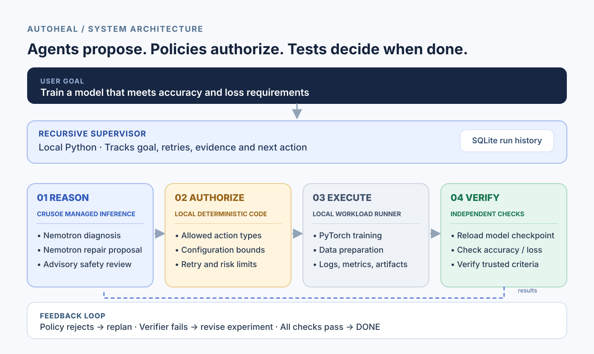
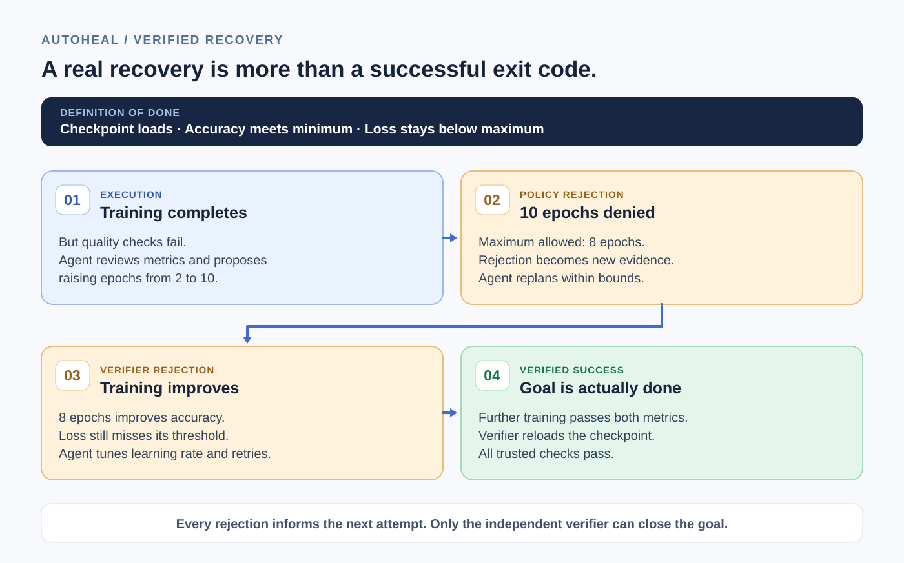

# AutoHeal — Recursive Agents for Self-Healing ML Pipelines

**An autonomous ML recovery system that knows the difference between a
successful execution and a completed goal.**

**Crusoe Recursive Agents Hackathon** (NVIDIA · You.com) · **Primary track: Done
Means Done** · solo project.
📹 **1-minute demo:** _link added at submission._

ML pipelines don't always fail with an exception. Sometimes training finishes
successfully but produces a model that fails its quality requirements. Other
times, fixing a failure requires a configuration change that violates resource
or operational constraints.

AutoHeal closes this loop with NVIDIA Nemotron on Crusoe Managed Inference. Its
agents diagnose failures, propose bounded repairs, incorporate policy feedback,
and recursively replan. A deterministic policy engine controls which actions
execute, while an independent verifier checks actual artifacts and trusted
acceptance criteria.

**The agent proposes. Policy authorizes. Independent verification determines
when the job is done.**

---

## AutoHeal in action — a real recovery

A real `rejection` run on NVIDIA Nemotron-3-Super-120B via Crusoe (full trace:
[`demo/example-trace.json`](demo/example-trace.json)):

```
Attempt 1  underfit (val 0.50, loss 1.51)             → verify FAIL
           diagnose UNDERFITTING → propose epochs 2→10
           POLICY REJECT: epochs=10 outside [1,5]      → replan
           propose epochs 2→5                          → ALLOW
Attempt 2  val 0.81, loss 1.15                          → verify FAIL
           re-diagnose → lr 0.002→0.01
Attempt 3  val 0.97, loss 0.34 (loss still too high)   → verify FAIL
           lr 0.01→0.05
Attempt 4  val 0.976, loss 0.09                         → verify PASS → ✅ COMPLETE
```

**Validation accuracy 0.50 (verification failed) → 0.976 (verified).** Nemotron
proposes 10 epochs → the deterministic policy rejects it above the 5-epoch
budget and discloses the limit → the agent replans within budget → two more
learning-rate adjustments → final loss 0.09 and independent verification passes.

Measured for this run: **4 workload executions, 4 diagnosis/plan cycles, 1
policy rejection, ~13 Nemotron calls, ~150 s end to end** — fully autonomous, no
human in the loop.

---

## Architecture

**Nemotron proposes, deterministic policies authorize, and the independent
verifier determines whether the original objective is complete.** A reasoning
agent is never allowed to declare its own success.

### System architecture



### How recursive recovery works

AutoHeal runs **reason → act → observe → verify → re-plan** until the goal is
independently verified or budgets force escalation — not a fixed retry loop. On
each cycle the agent changes the *desired state* from a diagnosis of real
evidence; a deterministic gate decides whether that state is admissible; and the
verifier decides whether the original goal is met. (A retry loop re-runs the
same thing; a Kubernetes operator reconciles to a *fixed* desired state. Agents
adapt; policies authorize; the split is the point.)



**Components** (full write-up in [`docs/architecture.md`](docs/architecture.md)):

- **Supervisor** (`agents/supervisor.py`) — owns the goal, drives the recursive
  loop, enforces budgets, refuses to re-run an already-tried config, escalates.
- **Acceptance-criteria agent** (`agents/acceptance.py`) — turns the goal into
  checks, **reconciled against a trusted minimum** it cannot weaken.
- **Diagnostician** (`agents/diagnostician.py`) — root-causes from real evidence.
- **Remediation planner** (`agents/remediation_planner.py`) — one structured,
  policy-aware proposed action.
- **Safety reviewer** (`agents/safety_reviewer.py`) — advisory; flags prompt
  injection in logs and risky actions. Not a substitute for the policy gate.
- **Policy engine** (`engine/policy.py`) — deterministic, binding: allowed
  actions, parameter ranges, blast-radius / iteration budgets.
- **Verifier** (`engine/verification.py`) — deterministic; re-loads the
  checkpoint and re-checks metrics. Authoritative over any agent claim.
- **State** (`engine/state.py`) — SQLite trace of every attempt, decision, and
  verification; exported to JSON per run.
- **Executor** (`workloads/local_executor.py`) + **workloads**
  (`workloads/train.py`, `workloads/dataprep.py`) — a workload-agnostic
  subprocess executor running either PyTorch training or data preparation.

The executor is the only infra-touching component. **No Kubernetes controller is
implemented in this prototype** — the controller comparison is an architectural
analogy; a Kubernetes Job / Kubeflow TrainJob / Spark adapter would reimplement
just that interface, reusing all agent logic unchanged.

---

## What AutoHeal demonstrates

| Engineering challenge | Implemented solution |
|---|---|
| Successful process ≠ completed goal | Independent artifact + metric verification |
| Agent proposes an invalid configuration | Deterministic policy rejection |
| A fix doesn't achieve the goal | History-aware diagnosis and replanning |
| Agent could weaken the success criteria | Reconciliation against trusted minimum requirements |
| Infinite retries / repeated configurations | Bounded execution and no-progress guards |
| Different workload types | Shared workload-agnostic executor interface |

---

## Scenarios (all produce *real* failures on CPU)

Two workload types share the same recovery engine: real PyTorch training and a
local data-preparation workload with modeled executor resource limits. PyTorch
failures arise from actual training behavior, while the data-preparation
scenario safely emulates resource-budget enforcement without exhausting the host
— the resource-limit semantics Spark/Kubernetes use for executor OOM-kills.

| Scenario | Workload | Starting fault | What it demonstrates |
|---|---|---|---|
| `lr_divergence` | training | `lr=5.0` → loss goes NaN, process exits 1 | diagnosis of a real crash → bounded fix → verified recovery (2 executions) |
| `underfit` | training | `lr=0.002, epochs=3` → exits 0 but val-acc ≈ 0.50–0.62 | **success ≠ done**: the verifier fails a run that "succeeded" → replan |
| `rejection` | training | `lr=0.002, epochs=2` under a tight epoch budget (ceiling 5) | the agent overshoots the budget, the **policy gate rejects it and discloses the limit**, and it replans within budget |
| `dataprep_oom` | data prep | 4-partition job needs ~1.2 GB vs a 512 MB executor limit → executor OOM, exits 1 | **"adjusting resources after an OOM failure"** — agent repartitions (or raises executor memory, bounded by the node cap) and re-runs |
| `full` | training | `lr=5.0, epochs=3` | loss blows up to a finite-but-huge value (exit 0, garbage accuracy) → caught by the verifier → recovery |

No NVIDIA GPU is used, so AutoHeal does not fake a CUDA OOM; the failures above
are authentic CPU-reproducible failures or faithfully modeled resource limits.

---

## Quickstart

```bash
python3 -m venv .venv && source .venv/bin/activate
pip install -r requirements.txt         # or: pip install -r requirements.txt --index-url <your-mirror>

cp .env.example .env                     # then edit .env
# set CRUSOE_API_KEY, then discover model ids:
python main.py models
# put a chosen Nemotron id into CRUSOE_MODEL in .env, then:

python main.py run --scenario rejection         # success != done + policy rejection + recovery
python main.py run --scenario lr_divergence     # real crash -> bounded fix -> verified recovery
python main.py run --scenario dataprep_oom      # executor OOM -> repartition -> recovery
python main.py trace <run_id>                    # full JSON recovery trace
```

Dev/CI without a key or network (deterministic stub, **not** for the demo):

```bash
python main.py run --scenario underfit --offline
```

**Where Crusoe Managed Inference appears:** every reasoning step — acceptance
criteria, diagnosis, remediation planning, and the safety review — is a call to
a Crusoe-hosted NVIDIA Nemotron model via the OpenAI-compatible endpoint
(`autoheal/llm/crusoe_client.py`). Crusoe inference is in the decision loop, not
just a final summary. Only inference runs on Crusoe; the supervisor, executor,
policy engine, and verifier run locally.

---

## Built vs. used

Solo project — everything under "built" is original work created during the
hackathon.

**Built during the hackathon:** recursive supervisor, acceptance-criteria
reconciliation against a trusted minimum, diagnostic and planning agents,
deterministic policy engine, independent verifier, persistent recovery traces,
workload-agnostic execution, and reproducible failure scenarios.

**Powered by:** NVIDIA Nemotron served through Crusoe Managed Inference,
PyTorch, and standard Python libraries (`openai`, `pydantic`, `numpy`).

**Future integrations (not implemented):** Kubernetes Jobs, Kubeflow Trainer,
Spark Operator, NeMo Switchyard, and versioned self-improving playbooks. The
agent logic is structured so these slot in behind existing interfaces.

## Demo video

_Link added at submission._
