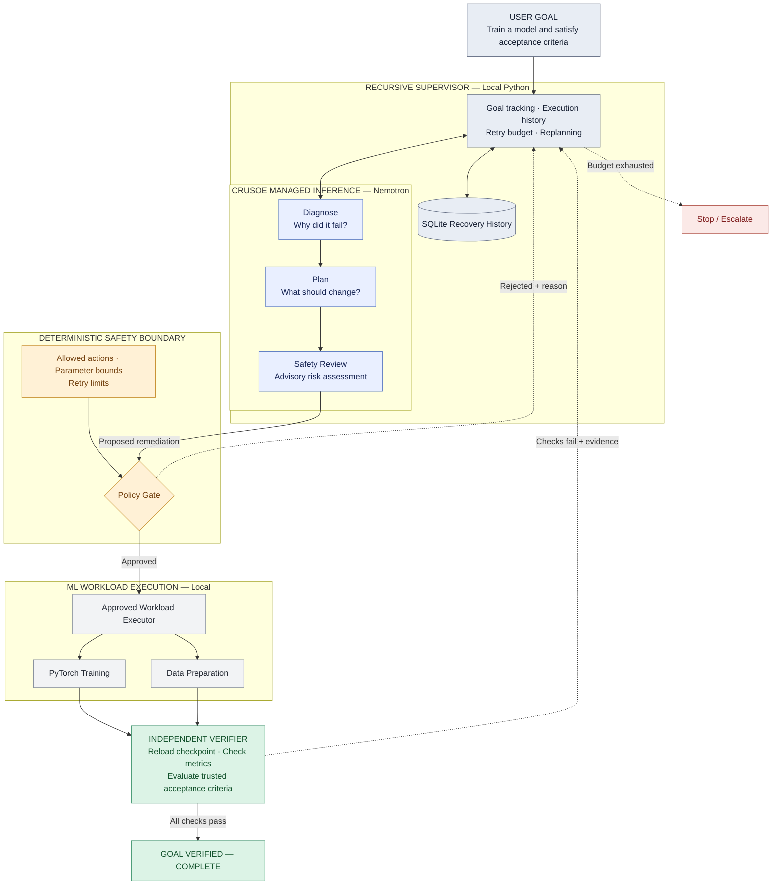
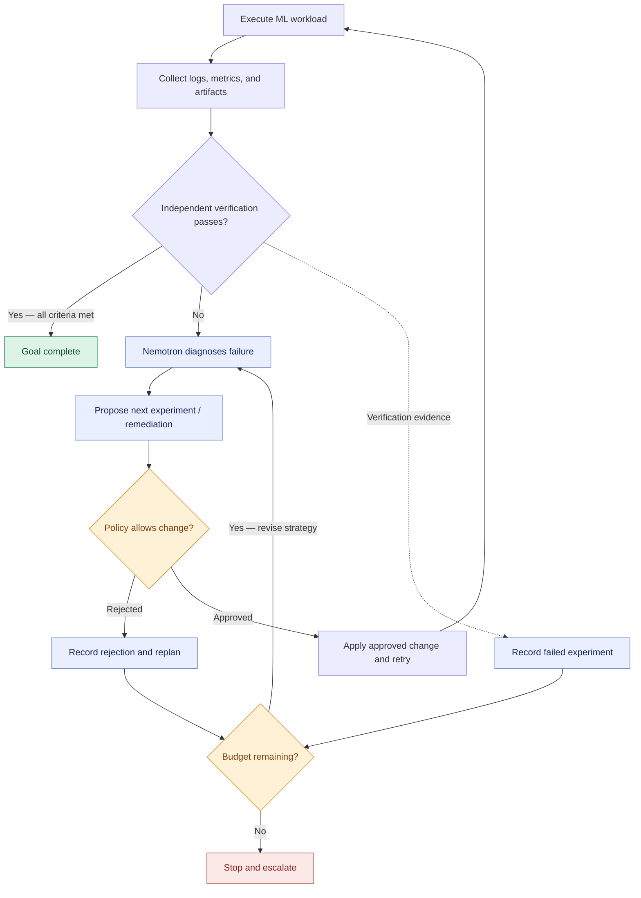

# AutoHeal — Recursive Agents for Self-Healing ML Pipelines

**Crusoe Recursive Agents Hackathon** (NVIDIA · You.com) — October 17, 2026.
**Primary track: Done Means Done.**

AutoHeal is an autonomous agent team that runs a real ML training workload,
detects a genuine failure, diagnoses it with LLM reasoning over actual
execution evidence, proposes a bounded fix, enforces that fix through a
deterministic policy gate, retries, and then **independently verifies that the
original goal is actually complete** — not just that a step stopped erroring.

The guiding principle:

> **Controllers reconcile. Agents adapt. Policies enforce. Independent tests
> decide when we're done.**

A reasoning agent is never allowed to declare its own success. A deterministic
verifier re-loads the artifacts and re-checks the metrics, and a trusted
acceptance-criteria spec — not the agent — sets the bar.

---

## What it does (one loop)

AutoHeal turns a one-line goal into explicit checks, then runs an autonomous
**reason → act → observe → verify → re-plan** loop until the goal is
independently verified or budgets force escalation — not a fixed retry loop.
The system architecture and the recursive recovery algorithm are diagrammed in
[Architecture](#architecture) below.

## Why it's not just a retry loop or a Kubernetes operator

- A retry loop re-runs the same thing. AutoHeal *changes the desired state*
  based on an LLM diagnosis of real evidence, and **re-plans** when a fix is
  rejected or fails verification.
- A Kubernetes operator reconciles to a *fixed* desired state. AutoHeal uses an
  agent to *propose a new* desired state, then a deterministic gate (the operator
  analogue) decides if that state is admissible. Agents adapt; controllers
  reconcile; the split is the point.

---

## Quickstart

```bash
python3 -m venv .venv && source .venv/bin/activate
pip install -r requirements.txt         # or: pip install -r requirements.txt --index-url <your-mirror>

cp .env.example .env                     # then edit .env
# set CRUSOE_API_KEY, then discover model ids:
python main.py models
# put a chosen Nemotron id into CRUSOE_MODEL in .env, then:

python main.py run --scenario lr_divergence     # real failure -> recovery
python main.py run --scenario underfit          # 'succeeded' but not done -> replan
python main.py trace <run_id>                    # full JSON recovery trace
```

Dev/CI without a key or network (deterministic stub, **not** for the demo):

```bash
python main.py run --scenario underfit --offline
```

### Where Crusoe Managed Inference appears

Every reasoning step — acceptance criteria, diagnosis, remediation planning, and
the safety review — is a call to a Crusoe-hosted NVIDIA Nemotron model via the
OpenAI-compatible endpoint (`autoheal/llm/crusoe_client.py`). Crusoe inference is
in the decision loop, not just a final summary. Only inference runs on Crusoe;
the supervisor, executor, policy engine, and verifier run locally.

---

## Scenarios (all produce *real* failures on CPU)

AutoHeal drives **two workload types behind one agent loop** — distributed-style
data preparation and PyTorch training — which is the "one API for data + AI,
drivable by agents" idea from the KubeCon direction below.

| Scenario | Workload | Starting fault | What it demonstrates |
|---|---|---|---|
| `lr_divergence` | training | `lr=5.0` → loss goes NaN, process exits 1 | diagnosis of a real crash → bounded fix → verified recovery (2 executions) |
| `underfit` | training | `lr=0.002, epochs=3` → exits 0 but val-acc ≈ 0.50–0.62 | **success ≠ done**: the verifier fails a run that "succeeded" → replan |
| `rejection` | training | `lr=0.002, epochs=2` under a tight epoch budget (ceiling 8) | the agent overshoots the budget, the **policy gate rejects it and discloses the limit**, and it replans within budget |
| `dataprep_oom` | data prep | 4-partition job needs ~1.2GB vs a 512MB executor limit → executor OOM, exits 1 | the KubeCon case: **"adjusting resources after an OOM failure"** — agent repartitions (or raises executor memory, bounded by the node cap) and re-runs |
| `full` | training | `lr=5.0, epochs=3` | loss blows up to a finite-but-huge value (exit 0, garbage accuracy) → caught by the verifier → recovery |

There is no NVIDIA GPU on the dev MacBook, so AutoHeal does not fake a CUDA OOM. The
training failures are authentic CPU-reproducible failures; the data-prep OOM
enforces a declared **executor memory budget** (the resource-limit semantics
Spark/k8s use), which is modeled deterministically rather than by exhausting the
host — safe, and faithful to how executors are OOM-killed.

---

## Architecture

**Nemotron proposes, deterministic policies authorize, and the independent
verifier determines whether the original objective is complete.**

### System architecture



### Recursive recovery and verification

How the loop handles policy rejection, verification failure, replanning, and
bounded execution:



Blue = Nemotron reasoning (proposes). Amber = deterministic policy (authorizes
and bounds). Green = goal verified complete. Red = bounded stop / escalation.

### Recorded recovery trace

A real `rejection` run (full trace in [`demo/example-trace.json`](demo/example-trace.json)):

```
Attempt 1  underfit (val 0.50, loss 1.51)             → verify FAIL
           diagnose UNDERFITTING → propose epochs 2→10
           POLICY REJECT: epochs=10 outside [1,5]      → replan
           propose epochs 2→5                          → ALLOW
Attempt 2  val 0.81, loss 1.15                          → verify FAIL
           re-diagnose → lr 0.002→0.01
Attempt 3  val 0.97, loss 0.34 (loss still too high)   → verify FAIL
           lr 0.01→0.05
Attempt 4  val 0.976, loss 0.09                         → verify PASS → ✅ COMPLETE
```

See [`docs/architecture.md`](docs/architecture.md) for the full write-up.
Components:

- **Supervisor** (`agents/supervisor.py`) — owns the goal, drives the recursive
  loop, enforces budgets, refuses to re-run an already-tried config, escalates.
- **acceptance-criteria agent** (`agents/acceptance.py`) — turns the goal
  into checks, **reconciled against a trusted minimum** it cannot weaken.
- **Diagnostician** (`agents/diagnostician.py`) — root-causes from real evidence.
- **Remediation planner** (`agents/remediation_planner.py`) — one structured,
  policy-aware proposed action.
- **Safety reviewer** (`agents/safety_reviewer.py`) — advisory; flags prompt
  injection in logs and risky actions. Not a substitute for the policy gate.
- **Policy engine** (`engine/policy.py`) — deterministic, binding: allowed
  actions, parameter ranges, blast-radius / iteration budgets.
- **Verifier** (`engine/verification.py`) — deterministic; re-loads the
  checkpoint and re-checks metrics. Authoritative over any agent claim.
- **State** (`engine/state.py`) — SQLite trace of every attempt, decision, and
  verification; exported to JSON per run.
- **Executor** (`workloads/local_executor.py`) + **workloads**
  (`workloads/train.py`, `workloads/dataprep.py`) — a workload-agnostic
  subprocess executor running either real PyTorch training or Spark-style data
  prep, selected per scenario.

The executor is the only infra-touching component; a Kubernetes Job / Kubeflow
TrainJob / Spark adapter would reimplement just that interface, reusing all
agent logic unchanged.

---

## What is built vs. what is used

Solo project. Everything under "built" below is original work created during the
hackathon.

**Built during the hackathon (all original):** the recursive supervisor and its
budget/no-progress guards; the stage-aware acceptance-criteria reconciliation
against a trusted minimum (the agent may only tighten metric thresholds, never
invent structural checks); the diagnostician / planner / safety agents and their
prompts; the deterministic policy engine; the independent deterministic verifier;
the SQLite trace store and JSON export; **two real workloads** — a PyTorch
training job and a Spark-style data-prep job with executor-memory limits — both
with emergent (not simulated) failures, behind one workload-agnostic executor
and one agent loop; the CLI and narrated trace.

**Third-party libraries:** `openai` (Crusoe OpenAI-compatible client), `torch`,
`pydantic`, `python-dotenv`, `numpy`. Reasoning models are NVIDIA Nemotron,
hosted by Crusoe Managed Inference.

**Tested and working:** full loop end-to-end offline and against Crusoe for the
scenarios above (see a saved trace in `demo/`).

**Planned, not implemented:** Kubernetes Job / Kubeflow Trainer / Spark Operator
executors; NeMo Switchyard model routing; versioned self-improving playbooks
(Track 3). The agent logic is structured so these slot in behind existing
interfaces.

## Demo video

_Link added at submission._
