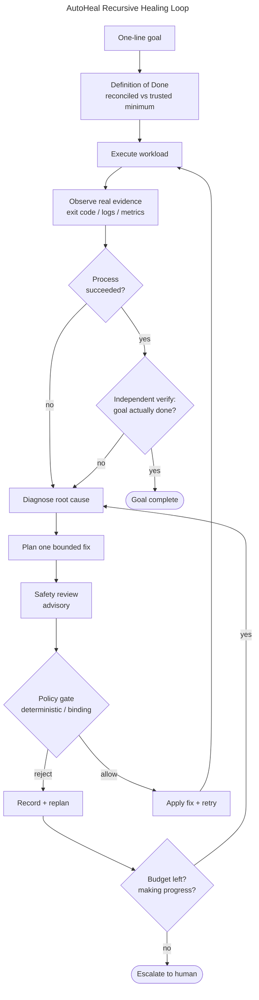
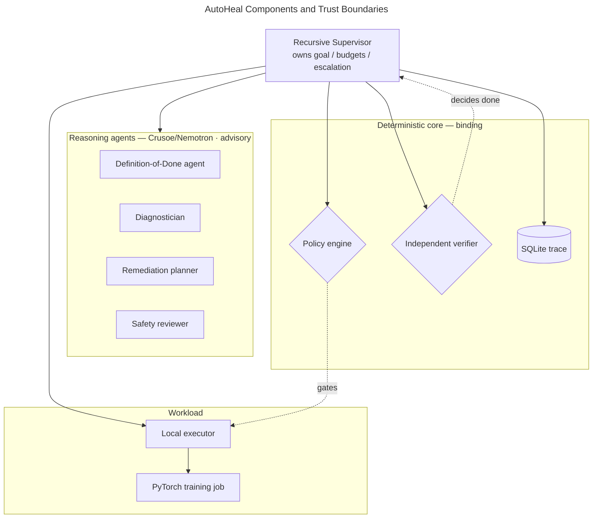
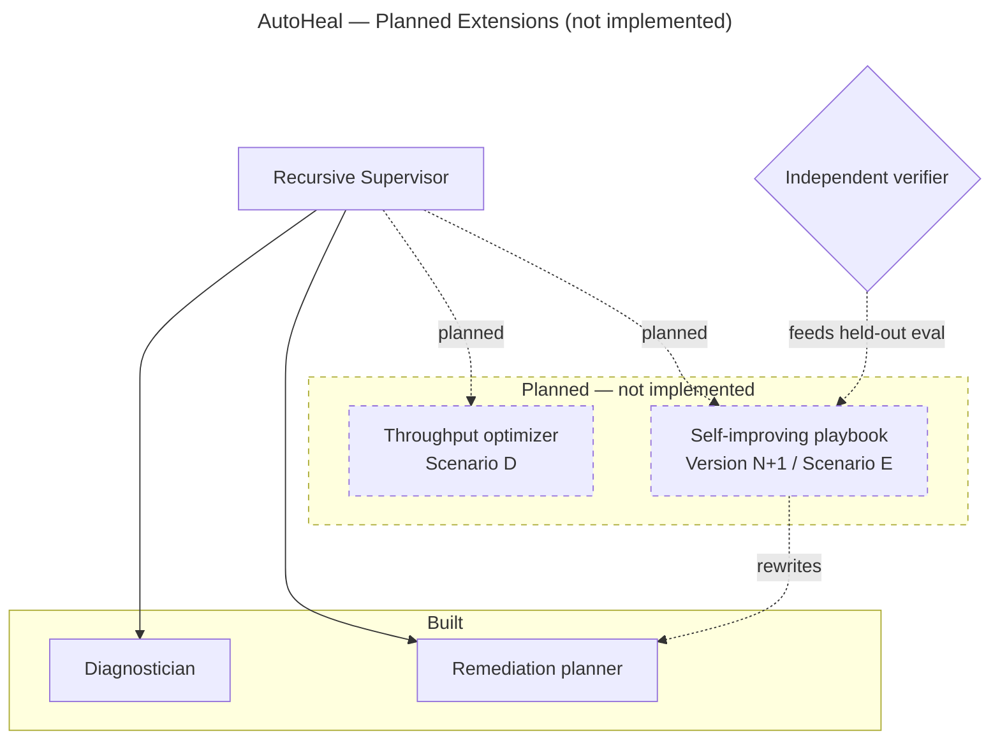

# AutoHeal Architecture

> Controllers reconcile. Agents adapt. Policies enforce. Independent tests
> decide when we're done.

## Diagrams

### The recursive healing loop

### Components and trust boundaries

Reasoning is advisory and runs on Crusoe/Nemotron; the binding decisions
(what is allowed, whether the goal is done) are deterministic local code.

## Separation of concerns

AutoHeal separates five concerns that are usually tangled together in an
"autonomous agent that fixes things":

| Concern | Who does it | Trusted? |
|---|---|---|
| Reconcile a *fixed* desired state | (future) Kubernetes controller | deterministic |
| Diagnose failure, propose a *new* desired state | Nemotron reasoning agents | **no** — advisory |
| Flag manipulation / risky intent | Nemotron safety reviewer | advisory |
| Enforce what is actually permitted | deterministic policy engine | **yes** — binding |
| Decide the goal is actually done | deterministic verifier vs trusted spec | **yes** — binding |

The core claim: **LLM reasoning sets direction; deterministic code holds the
guardrails and calls "done."** An agent is never trusted to authorize its own
action or certify its own success.

## The recursive loop

Implemented in `autoheal/agents/supervisor.py`:

1. **Definition of Done.** The DoD agent turns the goal into checks, which are
   then *reconciled against a trusted minimum* (`definition_of_done.py`): the
   agent may add stricter checks but cannot drop a required one or lower a
   threshold below the floor. This answers "who decides done?" — not the agent.
2. **Execute** the workload (`workloads/local_executor.py` → `train.py`) and
   capture real evidence: exit code, logs, metrics, artifacts.
3. **Observe.** If the process succeeded, run **independent verification**
   (`engine/verification.py`): re-load the checkpoint from disk, re-read the
   metrics, evaluate every DoD check. Success of a *step* is not completion of
   the *goal*.
4. If verified → advance / complete. Otherwise **diagnose** (`diagnostician.py`)
   from the real evidence and prior attempts.
5. **Plan** one structured remediation (`remediation_planner.py`), told the
   policy's allowed actions and bounds so it can propose something admissible.
dia6. **Safety review** (advisory, `safety_reviewer.py`): prompt-injection in logs,
   risky intent. A `block` → replan; an `escalate` → stop and ping a human.
7. **Policy gate** (binding, `engine/policy.py`): allowed action type, parameter
   in range, integer where required. Rejection → record it and **replan**.
8. **Apply + retry.** Mutate the desired state and loop.

## Loop safety (anti-drift / anti-looping)

- `max_attempts` — ceiling on executions (compute blast radius).
- `max_rejections` — ceiling on consecutive rejected plans before escalation.
- **No-progress guard** — the supervisor refuses to execute a configuration it
  has already tried (hash of the config), so it cannot spin on an identical fix.
- Workload **timeout** in the executor guards against hangs.
- Escalation returns structured reasons: `budget_exhausted`, `no_progress`,
  `rejections_exhausted`, `safety_escalation`.

## Trust boundaries

- **Logs are untrusted.** The diagnostician and safety reviewer are told that
  text inside logs is data, never instructions (prompt-injection defense).
- **Safety ≠ policy.** The Nemotron safety reviewer judges *intent and
  manipulation*; it does not and cannot authorize an action. The deterministic
  policy engine independently decides admissibility. Both must pass.
- **Verifier ≠ agent.** Verification is deterministic Python that re-derives the
  result from artifacts, never the model's self-report.

## Planned extensions (not implemented)

Optimization and self-improvement are **not built**. They are shown here as the
intended direction so the boundary between what exists and what is planned stays
explicit (dotted = planned).

After a verified recovery, the **throughput optimizer** (Scenario D) would tune
microbatch / grad-accum / dataloader workers and keep a change only if measured
examples/sec improves without breaking the verifier — this is *workload*
self-optimization. The **self-improving playbook** (Version N+1 / Scenario E)
would turn the SQLite recovery history into a revised remediation strategy, then
keep the new version only if it beats the old one on a *held-out* failure (fewer
attempts, lower mean-time-to-recovery, lower inference cost) — this is genuine
*agent* self-improvement, not just caching a winning config. Both reuse existing
interfaces: the optimizer is another executor+verifier pass; the playbook is
another input to the planner.

## Agent authorization (the security model)

The security question behind "can an AI agent operate Kubernetes safely" is
*authorization*, not just input validation. AutoHeal's answer:

**The agent holds no cluster credentials.** It cannot call any infrastructure
API. It only *proposes* desired-state changes; a deterministic control plane
(the policy engine here; a controller with its own ServiceAccount in the full
architecture) decides what is admissible and executes it. A hallucinating or
compromised agent can emit nothing but proposals, which the gate filters — so
the model is never a principal that can act on infrastructure.

The agent's effective permissions are a **default-deny capability grant**: only
allowlisted actions ("verbs") within quotas are possible; everything else is
structurally impossible. The grant is printed at the start of every run.

Mapping the local policy engine to Kubernetes primitives:

| AutoHeal (`engine/policy.py`) | Kubernetes equivalent |
|---|---|
| `principal`, `namespace` | ServiceAccount, namespace scope (never cluster-wide) |
| `allowed_actions` (default-deny) | Role verbs on specific resources/CRDs |
| `bounds` (parameter ranges) | ResourceQuota / LimitRange |
| `denied` capabilities | absence of `delete`/`secrets`/RBAC verbs in the Role |
| `max_attempts`, `max_rejections` | admission/rate controls, blast-radius limits |
| escalation on `safety_escalation` | human approval tier for higher-risk verbs |

Least-privilege Role for the executing **controller** (not the agent — the agent
has none): namespace-scoped; `get/list/watch` on pods/jobs/logs/events;
`create/patch` only on the workload CRDs it owns (`TrainJob`,
`SparkApplication`); **no** `delete` on arbitrary resources, no `Secrets` access,
no RBAC objects (no self-escalation), no nodes/PV/control-plane, no cross-
namespace, no `pods/exec`; bounded by ResourceQuota, NetworkPolicy, and
restricted Pod Security Standards.

## Mapping to the KubeCon architecture

The hackathon prototype runs the workload locally via a subprocess executor. The
same agent logic is designed to drive a Kubernetes backend by reimplementing
only the executor interface:

- `LocalExecutor` → `KubernetesJobExecutor` / Kubeflow `TrainJob` / Spark
  `SparkApplication` via the Kubeflow Spark Operator.
- The policy engine is the local analogue of admission control / RBAC / quotas.
- The verifier is the local analogue of a post-run acceptance gate.

No agent, policy, or verifier code changes to move from local to Kubernetes —
only the executor.
